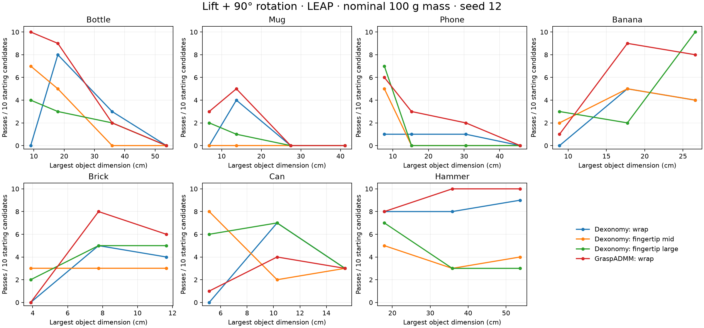

# Object size, contact choice, and functional grasping

**Local experimental investigation — 16 October 2026.** Donald; LEAP hand; native Dexonomy and GraspADMM. [Interactive measured-state examples and videos](viewer/index.html) · [all condition counts](summary.csv) · [object provenance](objects.json).

## What we learned

The experiments support a narrower, more useful version of the hypothesis: **a configuration that holds one object well can be unsuitable at another scale or for another intended use. Choosing contacts, the optimization method, and the enclosure command can help—but no single adjustment worked everywhere.**

Three concrete recoveries:

1. A 34 mm-diameter bottle produced **0/10 accepted grasps with the fixed Dexonomy wrap configuration**, but **10/10 passed all three physical tests with default GraspADMM on the same initializations**. This is a stronger existing optimizer solving the problem, not evidence that an agent is necessary.
2. For a 179 mm-long hammer, ordinary grasps often held the head. Handle-targeted contact matching plus a fingertip template produced **4/10 grasps passing the repository test, relative retention, movement, and our handle-only contact criterion**. A new random seed produced **2/10**, versus **0/10 functionally eligible grasps from the fixed ADMM-wrap baseline**.
3. One brick grasp passed the repository test but was ejected during movement. Keeping its optimized pose unchanged and using **one quarter of the original squeeze displacement** recovered that exact candidate. Across two brick sizes, motion passes improved **6/20 → 11/20**; passes of all three physical tests improved **6/20 → 10/20**.

There are equally important negative results. Longer optimization did not improve the small-object motion total. A shorter pregrasp opening did not improve it either. The oversized bottle remained unsuccessful in movement. The largest mug remained unsuccessful in the combined tests. A template choice that looked better on the first seed became worse on the second.

**This is evidence for adaptive selection and physical feedback, not proof that an LLM agent outperforms a well-designed rule-based selector or template search.**

## Objects and experimental controls

Seven geometries were evaluated at 24 size conditions. These are deliberately different shapes: cylindrical bottle, hollow mug with handle, thin phone, curved banana, rectangular can, brick, and asymmetric hammer.

| Geometry | Source | Scales tested | Largest dimension, cm |
|---|---|---|---|
| Bottle | Released Dexonomy/DGN_5k mesh | 0.05, 0.10, 0.20, 0.30 | 8.95, 17.91, 35.82, 53.73 |
| Mug | Released Dexonomy/DGN_5k mesh | 0.05, 0.10, 0.20, 0.30 | 6.86, 13.71, 27.42, 41.13 |
| Phone | Released Dexonomy/DGN_5k mesh | 0.05, 0.10, 0.20, 0.30 | 7.62, 15.25, 30.49, 45.74 |
| Banana | YCB geometry distributed with Isaac Gym | 0.5, 1.0, 1.5 | 8.87, 17.74, 26.61 |
| Can | YCB geometry distributed with Isaac Gym | 0.5, 1.0, 1.5 | 5.13, 10.27, 15.40 |
| Brick | YCB geometry distributed with Isaac Gym | 0.5, 1.0, 1.5 | 3.88, 7.77, 11.65 |
| Hammer | MetaWorld hammer geometry | 0.5, 1.0, 1.5 | 17.90, 35.80, 53.70 |

The YCB objects use convex collision proxies; the banana's concavity is therefore not represented. The hammer uses separate meshes converted from its source primitives, with uniform-density mass distribution rather than MetaWorld's original component masses. The original DGN collision decompositions are retained. Units for the YCB meshes were read from their URDFs, not guessed from mesh coordinates. Exact dimensions, source paths, hashes, and representation changes are in `objects.json` and `prepare.py`.

The source density convention targets a **nominal 100 g**, independently of scale, to separate geometric effects from increasing weight. A compiled-model check found approximately **99.1 g for the bottle, 95.2 g for the mug, 97.9 g for the phone, and 100 g for the other four geometries**, because the original mesh metadata and collision volumes differ slightly (`mass-check.json`). The same convention and collider are used in each matched comparison. This deliberately makes very large objects lighter than many real counterparts. Object pose, hand, collider, friction, and tests were held fixed across each comparison. There is no table, floor, or neighboring object supporting the grasp.

Each condition receives ten retained initialization candidates, generated from 1,024 surface samples × eight in-plane orientations and 100 matching iterations. Candidates rejected by optimization still count in the denominator. Source initialization filters can pad their output with less-qualified candidates; their message “10 valid” is not treated as ten successful grasps.

This is a **controlled one-epoch pilot**, not the authors' full dataset-generation campaign: the source initialization default has five epochs, and template evolution is disabled here to prevent cross-condition contamination. The optimization settings themselves are the source defaults unless a change is explicitly identified. The released LEAP wrap, middle-fingertip, and large-fingertip templates are tested, so conclusions do not depend only on deliberately choosing one unsuitable template.

The investigation completed **1,320 optimization attempts across configurations**, plus **40 derived enclosure-command variants** and **36 perturbation checks of selected examples**. Four memory-only retries are recorded separately, not counted as additional independent trials. These are attempts, not 1,320 independent object instances.

## What “pass” means

All physics uses the native MuJoCo-based implementation, with MuJoCo 3.11.0. This is not an IsaacLab validation or a hardware experiment.

**Repository test.** Replay the generated pregrasp → grasp → squeeze. Apply object-weight force in each of six axis directions for two seconds, resetting between directions. The released test permits up to **5 cm translation and 15° rotation** from the initial object pose. Source: [evaluation configuration](https://github.com/JYChen18/Dexonomy/blob/d561ff9df8545deef7a3f9e7cfb4045ef66f6913/dexonomy/config/op/eval.yaml) and [simulation implementation](https://github.com/JYChen18/Dexonomy/blob/d561ff9df8545deef7a3f9e7cfb4045ef66f6913/dexonomy/sim/mujoco_env.py).

**Relative retention.** During the same six perturbations, require sampled object motion relative to the *actual hand root* below **1 cm / 15°**, at least two hand bodies with load-bearing contact, and hand–object penetration below **2 mm**. This separates object slip from motion of the compliant simulated wrist. We also retain the stricter world-coordinate measurements; they should not be interpreted as pure grasp slip.

**Movement.** After closing, lift 10 cm over one second, rotate 90° over two seconds, then hold for one second under object-weight loading. Require sampled object tracking error below **2 cm / 15°**, at least two load-bearing hand bodies, and hand–object penetration below **2 mm**. Measurements are taken every 20 ms; force-direction checks are sampled every 200 ms.

**Combined pass** means all three tests pass. The tests are not nested: a candidate can pass movement but fail a different force direction. “Below 2 mm” is a soft-contact simulation tolerance, not a claim of mathematically zero penetration. These checks do not certify every hand self-collision, hardware torque limit, or real-world stability condition.

**Hammer intent proxy.** In addition to the physical tests, all force-bearing contacts after closure must be on the handle. This is our declared criterion for preparing a hammering grasp. It is stricter than carrying the object, but it does **not** prove strike-face clearance, impact success, or nail insertion. Videos show actual closure and movement, not the optimizer's desired configuration.

## Scale and method comparison



Each main configuration attempted all 24 conditions × ten initializations. The ADMM run reused the exact wrap initializations; the two fingertip runs used their corresponding released templates with the same sampling seed and proposal budget.

| Fixed configuration | Accepted by optimizer | Repository test | Relative retention | Movement | Combined |
|---|---:|---:|---:|---:|---:|
| Dexonomy, wrap | 97/240 | 86/240 | 71/240 | 71/240 | 68/240 |
| Dexonomy, fingertip mid | 182/240 | 129/240 | 73/240 | 62/240 | 51/240 |
| Dexonomy, fingertip large | 147/240 | 128/240 | 89/240 | 75/240 | 70/240 |
| GraspADMM, wrap | 148/240 | 133/240 | 111/240 | 108/240 | 105/240 |

There is no universally best contact template. For example, the smallest can has movement results **0/10 wrap, 8/10 mid fingertips, 6/10 large fingertips, and 1/10 ADMM-wrap**. Conversely, ADMM-wrap is much better on the small bottle. The larger banana favors the large-fingertip template. A selector has useful choices to make, but strong fixed baselines already solve many cases.

For the bottle, fixed Dexonomy-wrap movement success is **0/10, 8/10, 3/10, 0/10** as diameter increases through approximately **34, 68, 137, 205 mm**. This is a size-dependent operating range, not simply “bigger is always worse.” Required-contact failures are visible in the saved filter logs on small objects; large objects also produce contact, retention, and motion failures.

The largest bottle with the large-fingertip template passes the repository test **9/10**, but movement and combined success are **0/10**. The selected viewer case has 24.8 mm movement tracking error, exceeding the 20 mm limit. That does not establish the source evaluator is incorrect; it demonstrates that its static tolerance does not guarantee our more precise moving-object requirement.

A more severe selected brick case passes the source test but loses the object during rotation, reaching **4.45 m** tracking error and approximately **20 mm** sampled penetration during the unstable motion. The visual evidence labels this as a selected severe failure, not typical behavior of every candidate.

## What the agent changed—and what did not help

### Contact regions must affect matching, not just initialization

After inspecting the hammer geometry, I first sampled proposals near its handle. This did **not** solve the small hammer's intended-use problem: the subsequent unconstrained matcher still returned head grasps. The source objective rewards geometrically convenient stable contacts; it has no instruction to preserve the head for use.

The stronger intervention uses a manually identified handle surface for **contact matching**, while collision checks, mass, center of mass, and physical evaluation retain the **complete hammer**. The selected raw-coordinate patch is `x < 0.08`; it is a source-geometry annotation, not a learned segmentation result. Together with the released middle-fingertip template, this gives handle-only contacts in all ten small-hammer candidates, but only **4/10** pass all physical tests. Correct semantics alone is not enough.

For the oversized mug, visual inspection identified its protruding handle on negative z. Restricting contact matching to `z < -0.4` in source coordinates, retaining the full collider, and using ADMM recovered **1/10 combined passes at the 27.4 cm size**. The 41.1 cm mug remained **0/10 combined**. This is a partial recovery with low candidate yield, not a solved large-object problem.

### More iterations and less opening were not general fixes

Matched ablations on the smallest size of each of the seven objects reused the middle-fingertip initializations:

| Change | Repository test | Movement | Combined |
|---|---:|---:|---:|
| Default, 20-iteration cap | 37/70 | 30/70 | 26/70 |
| 100-iteration cap, same early stopping | 38/70 | 30/70 | 27/70 |
| Pregrasp distance 45 → 15 mm | 38/70 | 29/70 | 26/70 |

The shorter opening also reduces the generation-stage pregrasp clearance filter from 40 to 12 mm; downstream evaluation criteria are unchanged. These results do not support blindly increasing iterations or shrinking all distances. The source may stop before the configured maximum.

### The enclosure controller can undo a good optimized pose

For two brick sizes, I kept the optimized grasp and pregrasp unchanged and scaled only the commanded joint displacement from grasp to squeeze:

`new_squeeze = grasp + multiplier × (original_squeeze − grasp)`

| Squeeze multiplier | Repository test | Movement | Combined |
|---|---:|---:|---:|
| 1.0, source command | 13/20 | 6/20 | 6/20 |
| 0.5 | 15/20 | 7/20 | 7/20 |
| 0.25 | 17/20 | 11/20 | 10/20 |

The severe brick failure above becomes a combined pass at 0.25, with **19.1 mm** maximum motion tracking error and **0.55 mm** maximum sampled penetration. At 0.5 it also recovers. This directly supports checking the *executed enclosure*, not only the optimized configuration. It does not establish that lower squeeze is universally better: the recovered 0.25 candidate fails the combined criteria when mass increases from 100 to 120 g.

## New-seed confirmation: useful gains, real regressions

A choice policy was frozen after inspecting seed 12, then tested at seed 29 with ten candidates per condition. The baseline is **ADMM-wrap**, the strongest global fixed configuration in the first sweep. When the selector chose ADMM itself, the identical result was reused rather than generating extra candidates. This tests new sampling on the **same objects**, not unseen-object generalization.

| Condition | Selected change | Baseline combined | Selected combined |
|---|---|---:|---:|
| Small bottle | Keep ADMM | 7/10 | 7/10 |
| Medium bottle | Keep ADMM | 7/10 | 7/10 |
| Large bottle, 137 mm diameter | Dexonomy wrap | 2/10 | 4/10 |
| Largest bottle, 205 mm diameter | Keep ADMM | 0/10 | 0/10 |
| Small mug | Keep ADMM | 1/10 | 1/10 |
| Small can | Middle-fingertip Dexonomy | 2/10 | 8/10 |
| Small phone | Large-fingertip Dexonomy | 6/10 | 4/10 |
| Small hammer | Handle contacts + middle fingertips | 5/10 | 2/10 |
| **Total, physical criteria only** | | **30/80** | **33/80** |

For the hammer, the baseline's five physically passing grasps fail the handle-only intent criterion, while both selected combined passes satisfy it. With the declared intent criterion applied to that row, the totals become **25/80 versus 33/80**. This small mixed-task total is descriptive, not a statistical superiority claim.

The phone regression is important. A choice based on one seed can be wrong. An effective agent should inspect evidence, retain alternatives, and verify a changed configuration rather than treating its semantic judgment as ground truth.

## Robustness of the selected examples

Each selected successful example was retested with six separate changes: ±2 mm x translation at reset, ±3° z rotation at reset, mass 100 → 120 g, and friction 0.6 → 0.5. Each row below counts passes of all three physical tests across these six checks; it is not a population success estimate.

| Selected example | Perturbation passes | Observed limitation |
|---|---:|---|
| Default medium bottle | 6/6 | No failure in these six checks |
| ADMM small bottle | 6/6 | No failure in these six checks |
| Middle-fingertip small can | 5/6 | +2 mm reset shift fails |
| Handle-targeted small hammer | 5/6 | −3° reset rotation fails |
| Gentler-squeeze brick | 5/6 | +20% mass fails |
| Region-targeted large mug, selected rare success | 6/6 | Low generation yield remains: only 1/10 combined passes |

Thus the improved examples are more than attractive configurations, but some still have narrow operating margins. These checks do not replace friction/contact-model variation across simulators or hardware tests.

## How this changes the research hypothesis

The best current hypothesis is not “datasets hide scale and an agent will fix the optimizer.” It is:

> Grasp synthesis has several interacting choices—contact topology, contact region, optimizer, enclosure strength, and task constraints. Their best settings vary with object geometry and intended use. An agent may be useful as a feedback-driven coordinator of those choices, provided it is judged on executed physical and task outcomes.

We did **not** establish that the source datasets contain only similarly sized objects. Dexonomy already supports multiple grasp types and hand-specific templates; it should receive that capability in a fair comparison. The [official repository](https://github.com/JYChen18/Dexonomy) describes template-based synthesis, while [Dexterous Functional Grasping](https://dexfunc.github.io/) already highlights object size, mass, and functional-contact challenges. Our contribution would need to be measured adaptation and reliable evaluation, not claiming those issues were previously unknown.

A useful next experiment is a preregistered comparison on unseen objects and sizes: (1) strongest single fixed configuration; (2) fixed template/parameter portfolio with search; (3) simple geometry-based rules; (4) agent-guided adaptation. Match simulator-call or wall-time budgets, count every failed proposal, and keep the physical evaluator separate from the adaptation loop. Add actual hammering/pouring tasks and test different hands. This pilot is promising enough to justify that study, but does not yet demonstrate a publishable agent advantage.

## Reproducibility and limitations

- Source: Dexonomy commit `d561ff9df8545deef7a3f9e7cfb4045ef66f6913`, with a clean upstream working tree. Native GraspADMM uses its default 50 outer steps, ten simulation substeps, rho 1000, object learning rate 2e-4. Dexonomy uses a 20-step cap and ten substeps. Candidate count is matched, not optimization time: ADMM costs more per candidate.
- Local code, configurations, initialization/grasp arrays, measured states, filter logs, per-command and per-stage receipts, plans, and failed attempts are retained under this study directory. `summary.csv` includes rejected attempts in denominators. `confirmation-plan.json` predates the confirmation outcomes.
- Four original mug optimizations hit MuJoCo arena allocation errors; a native evaluation also exhausted arena memory, and the first middle-template evaluation terminated with a segmentation fault. The bounded recovery increases arena capacity to 64 MiB without changing physics. All accepted candidates now have complete independent audit records; all four failed optimization attempts were retried and rejected normally. Errors were not counted as physical evidence of grasp failure.
- MuJoCo teardown issues are bypassed only after artifacts are flushed. Per-case simulation records, not process exit alone, support results. Original failed logs remain. The initial command-list files were replaced by later invocations; per-stage configuration/receipt files remain, and the launcher now preserves command history on subsequent invocations.
- The independent evaluator was extended to retain relative object–hand motion after initial inspection showed that world-coordinate drift conflates wrist compliance with slip. Original measurements and earlier audit files are preserved. This was exploratory analysis, not a preregistered benchmark.
- Seven geometries, one hand, two sampling seeds on a subset, manually annotated semantic regions, simplified collision assets, fixed mass, and a compliant floating wrist limit generalization. Ten candidates selected from one initialization batch are correlated; no binomial confidence claim is made from treating them as ten independent object trials.
- DexGraspNet's older LEAP/Wuji adapter and the ongoing IsaacLab/Grogu work are not included in this numerical comparison. No Grogu jobs, other project budgets, or research pauses were changed.

To rerun a fresh baseline from this directory, use the provided environment and a new output name:

```bash
python campaign.py \
  --run fresh-wrap --stages init,grasp,physical
```

`next_trials.py`, `followup_trials.py`, `confirm_trials.py`, and `mug_trials.py` specify the comparisons. Use fresh run names or a copied study directory when reproducing; do not overwrite this evidence. The local viewer is served through the existing port 8894 server at `/size-study/viewer/index.html`.
